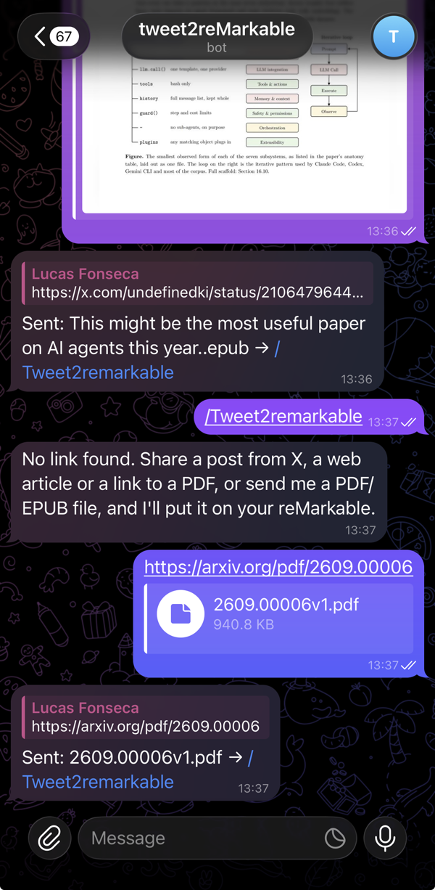
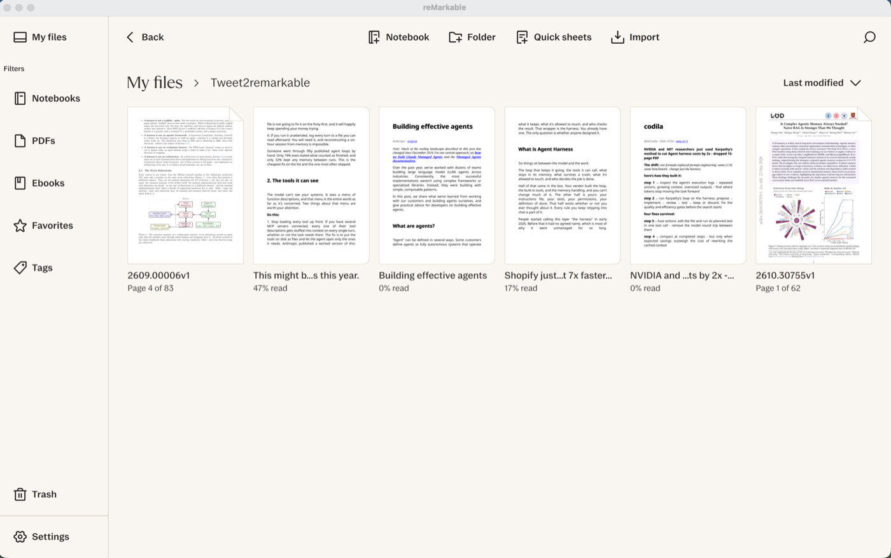
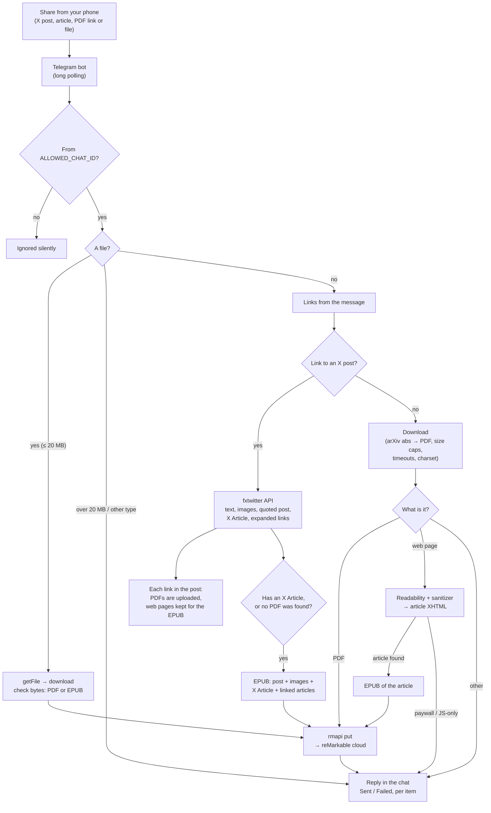
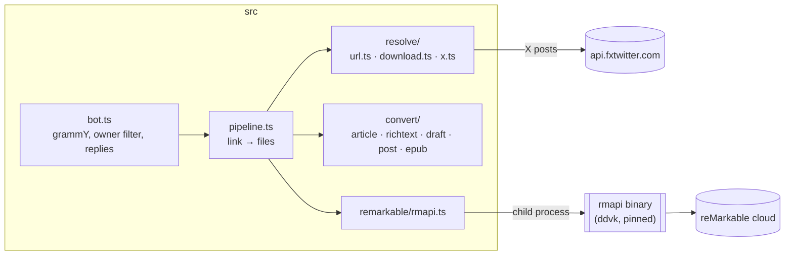

# tweet2remarkable

[](https://github.com/lucaslimafons/tweet2remarkable/actions/workflows/ci.yml)
[](LICENSE)
[](https://nodejs.org)

A personal Telegram bot: share a post from X, a web article, a link to a PDF, or a PDF/EPUB file to the bot from
your phone's share sheet, and it lands on your reMarkable at the next sync. Single user by design.

**Status:** PDF links, X posts (including X Articles), web articles, and PDF/EPUB files sent to the bot; Docker
image for 24/7 hosting. Commands (`/folder`) and thread unrolling come next.

<table>
  <tr>
    <td width="32%"></td>
    <td></td>
  </tr>
  <tr>
    <td align="center"><sub>Share to the bot; it answers per item</sub></td>
    <td align="center"><sub>Posts and articles arrive as EPUBs, papers as PDFs</sub></td>
  </tr>
</table>

## How it works



### What a share turns into

| You share | You get on the reMarkable |
|---|---|
| A link to a PDF (or an arXiv `/abs/` page) | That PDF |
| A link to a web article | One EPUB of the article, with its images, without the site's menus, ads and scripts |
| An X post linking to a PDF / arXiv paper | Just the PDF |
| An X post with an X Article (its own or a quoted one) | One EPUB: the post, its images, then the full article |
| An X post linking to web articles | One EPUB: the post, then up to 3 linked articles |
| An X post with nothing else (e.g. a long post) | One EPUB of the post: text, images, quoted post, list of links |
| A PDF or EPUB **file** (up to 20 MB) | That file, unchanged, under its own name |
| A file over 20 MB, or another file type | A reply explaining why: bots can only download files up to 20 MB |
| A paywalled or JavaScript-only page, or anything else | A clear "Failed: …" reply in the chat, never silence |

EPUB is used for posts and articles because it reflows on e-ink; PDFs are uploaded untouched. Generated EPUBs pass
[EPUBCheck](https://github.com/w3c/epubcheck) with no errors or warnings, including real pages from Paul Graham,
Anthropic, Joel on Software and Dan Luu.

Web pages are parsed with [Readability](https://github.com/mozilla/readability) in jsdom with scripts and
subresources disabled, then rebuilt from an allowlist of tags and attributes into strict XHTML: links and lazy images
are made absolute, Next.js image proxies are unwrapped to the original file, and scripts, iframes, forms and event
handlers never reach the EPUB.

### Pieces



- **X posts** are read through [fxtwitter](https://github.com/FxEmbed/FxEmbed) (free, no account), behind an
  `XResolver` interface so it can be swapped for the official X API if it ever breaks.
  X Articles arrive as Draft.js content and are rendered to XHTML with their images. See
  [docs/research.md](docs/research.md) for what the API returns.
- **Uploads** go through [rmapi](https://github.com/ddvk/rmapi) (the maintained `ddvk` fork), pinned to a fixed,
  checksum-verified release and run with `-ni` so it fails instead of hanging when it isn't paired. There is no
  official reMarkable API; rmapi is reverse-engineered and can break, so upload errors are always reported in the
  chat.

## Run your own

Every instance is fully separate: you create your own Telegram bot, use your own chat id and pair rmapi with your
own reMarkable account. Nothing is shared with this repository or with anyone else's bot.

- **Just run it** (on your machine, a Pi, a VPS): `git clone` this repository and follow [Setup](#setup-macos-or-linux).
- **Deploy it from GitHub** (e.g. Northflank building on every push): **fork** it, since the host needs a
  repository it can watch. Use GitHub's *Sync fork* button to pull in updates.

Your fork can't change this repository; improvements come back as pull requests.

## Setup (macOS or Linux)

Requires Node 24+ and pnpm.

```sh
pnpm install
pnpm rmapi:install        # pinned rmapi → ./bin/rmapi (checksum-verified)
cp .env.example .env
```

1. **Telegram bot:** create one with [@BotFather](https://t.me/BotFather) (`/newbot`) and put the token in
   `TELEGRAM_BOT_TOKEN`. Treat it like a password.
2. **Your chat id:** message [@userinfobot](https://t.me/userinfobot) and put your numeric id in `ALLOWED_CHAT_ID`.
   The bot refuses to start without it: anyone can find a bot's @, and this one writes to your tablet.
   Then open your bot and press **Start** once.
3. **Pair rmapi:** run `pnpm rmapi:pair`, open <https://my.remarkable.com/device/browser/connect>, paste the
   8-character code. The token is saved to `RMAPI_CONFIG` (default `./.secrets/rmapi.conf`). **That file is a
   secret: it grants access to your reMarkable cloud.** It is git-ignored; never commit it.

## Run

```sh
pnpm dev                                   # polling bot with reload
pnpm send https://x.com/user/status/123    # send one link without Telegram
pnpm preview <url>...                      # build the files into ./preview without uploading
pnpm test
```

On start the bot checks that rmapi runs, is paired and that the destination folder exists, then starts polling.
It only runs while the process is up; see [Deploy](#deploy-247) to keep it running.

## Deploy (24/7)

The bot is a single long-running process with no inbound ports, so any host that runs a container works. The
`Dockerfile` builds a small image (Node 24 running the TypeScript directly, plus the pinned rmapi for amd64/arm64)
that runs as a non-root user.

Pass the rmapi config as a secret, either:

- `RMAPI_CONFIG_B64`: the file's contents in base64 (`base64 < .secrets/rmapi.conf | tr -d '\n'`), or
- a mounted secret file, with `RMAPI_CONFIG` pointing at it (read-only mounts are fine: it is copied to a private temp
  file, since rmapi only needs to rewrite its short-lived user token).

Then check the deployment without starting a second poller: `node src/check.ts` (locally: `pnpm check`) verifies the
Telegram token, the rmapi pairing and the destination folder.

```sh
docker build -t tweet2remarkable .
docker run -d --restart unless-stopped \
  -e TELEGRAM_BOT_TOKEN=… -e ALLOWED_CHAT_ID=… -e REMARKABLE_FOLDER=/Inbox -e RMAPI_CONFIG_B64=… \
  tweet2remarkable
```

Only one process may poll a bot at a time: stop `pnpm dev` on your machine once the hosted bot is running, or both
will get `409 Conflict` from Telegram.

On [Northflank](https://northflank.com) (free Sandbox: always on, no sleeping): create a project, add a *combined
service* from this repository's `main` branch with the Dockerfile build, no ports, the smallest compute plan, and the
variables above as secrets. Pushing to `main` redeploys.

## Configuration

| Variable | Default | |
|---|---|---|
| `TELEGRAM_BOT_TOKEN` | required | From @BotFather |
| `ALLOWED_CHAT_ID` | required | Only this chat is served; others are ignored silently |
| `REMARKABLE_FOLDER` | `/Inbox` | Created if missing, e.g. `/Tweet2remarkable` |
| `RMAPI_CONFIG` | rmapi's default | Path to the rmapi auth file |
| `RMAPI_CONFIG_B64` | | The rmapi auth file's contents, base64 (for hosts without secret files) |
| `RMAPI_BIN` | `rmapi` | Path to the binary (`./bin/rmapi` after `rmapi:install`) |
| `MAX_DOWNLOAD_MB` | `50` | Larger files are refused |

## Notes

- Same-name documents aren't overwritten (that would wipe annotations); the upload gets a date suffix instead.
- rmapi only stores a long-lived device token in its config and derives a fresh user token on each run, so a
  read-only copy of the file (e.g. a mounted secret) works as long as `RMAPI_CONFIG` points to a writable copy.
- Threads aren't unrolled yet: fxtwitter only links a post to its parent.
- Without a Connect subscription, files not opened in 50 days leave the cloud (they stay on the tablet).

## License

MIT
