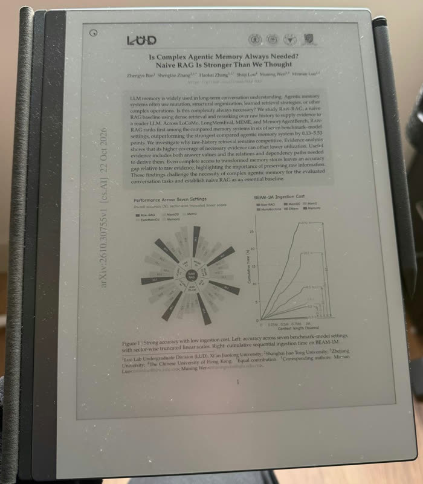
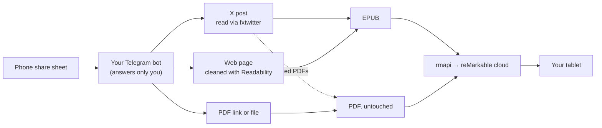

# tweet2remarkable

[](https://github.com/lucaslimafons/tweet2remarkable/actions/workflows/ci.yml)
[](LICENSE)
[](https://nodejs.org)

A personal Telegram bot: share a post from X, a web article, a link to a PDF, or a PDF/EPUB file to the bot from
your phone's share sheet, and it lands on your reMarkable at the next sync. Single user by design: you run your own.

<table>
  <tr>
    <td width="40%"></td>
    <td></td>
  </tr>
  <tr>
    <td align="center"><sub>Share to the bot; it answers per item</sub></td>
    <td align="center"><sub>A paper linked from an X post, on the tablet after its next sync</sub></td>
  </tr>
</table>

## What you get

| You share | You get on the reMarkable |
|---|---|
| A link to a PDF (or an arXiv `/abs/` page, or a Google Drive PDF shared with "Anyone with the link") | That PDF |
| A link to a web article | One EPUB of the article, with its images, without the site's menus, ads and scripts |
| An X post linking to a PDF / arXiv paper | Just the PDF |
| An X post with an X Article (its own or a quoted one) | One EPUB: the post, its images, then the full article |
| An X post linking to web articles | One EPUB: the post, then up to 3 linked articles |
| An X post with nothing else (e.g. a long post) | One EPUB of the post: text, images, quoted post, list of links |
| A PDF or EPUB **file** (up to 20 MB) | That file, unchanged, under its own name |
| Anything it can't handle | A "Failed: …" reply explaining why, never silence |

Sending the same thing twice never overwrites the first copy (that would wipe your annotations): the second one gets
a date suffix.

## How it works



The bot runs wherever you start it (your computer, a Pi, a free container host), polls Telegram for your messages,
builds the document and uploads it with [rmapi](https://github.com/ddvk/rmapi). The detailed flow, code layout and
design decisions are in [docs/architecture.md](docs/architecture.md).

## Requirements

- A **Telegram** account (the app on your phone, for the share sheet).
- A **reMarkable** with cloud sync (a free reMarkable account is enough; Connect isn't required).
- Somewhere to run it: **Node 24+** and **pnpm** on macOS/Linux, or **Docker**.

## Setup

```sh
git clone https://github.com/lucaslimafons/tweet2remarkable.git
cd tweet2remarkable
corepack enable           # provides pnpm (or: npm install -g pnpm)
pnpm install
pnpm rmapi:install        # pinned rmapi → ./bin/rmapi (checksum-verified)
cp .env.example .env
```

Then, once:

1. **Create your bot:** in Telegram, message [@BotFather](https://t.me/BotFather), send `/newbot`, pick a name and
   a username ending in `bot`. Put the token it gives you in `TELEGRAM_BOT_TOKEN`. Treat it like a password.
2. **Find your chat id:** message [@userinfobot](https://t.me/userinfobot) and put the number it replies with in
   `ALLOWED_CHAT_ID`. The bot refuses to start without it: anyone can find a bot's @, and this one writes to your
   tablet. Then open your bot and press **Start** once.
3. **Connect your reMarkable:** run `pnpm rmapi:pair`, open <https://my.remarkable.com/device/browser/connect>,
   and paste the 8-character code. The pairing is saved to `./.secrets/rmapi.conf`. **That file grants access to
   your reMarkable cloud**: it's git-ignored; never commit or share it.
4. **Check everything:** `pnpm check` should show four ✓ (Telegram token, chat id, rmapi, pairing + folder).

Start the bot with `pnpm dev`. It only runs while that terminal is open; see [Deploy](#deploy-247) to keep it on.

> **Clone or fork?** Every instance is separate: your own bot, chat id and reMarkable pairing; nothing is shared with
> this repository. Clone to run it on your own machine. Fork if a host should build it from GitHub (like Northflank
> below), and use *Sync fork* to get updates.

## Use it

- **From your phone:** in X, Safari/Chrome or the Files app, tap **Share → Telegram →** your bot. The bot replies
  `Sent: <name> → /<folder>` (or `Failed: …` with the reason) for each item.
- **Several links in one message** are handled one by one, each with its own reply.
- **Files:** share a PDF or EPUB to the bot (up to 20 MB, Telegram's limit for bots). Links in its caption are sent
  too.
- `/start` or `/help` shows a one-line reminder. Messages from anyone else are ignored.
- Documents go to `REMARKABLE_FOLDER` (default `/Inbox`, created if missing).

## Deploy (24/7)

The bot is one long-running process with no inbound ports, so any host that runs a container works. The
`Dockerfile` builds a small image (Node 24 plus the pinned rmapi, amd64/arm64) that runs as a non-root user.

```sh
docker build -t tweet2remarkable .
docker run -d --restart unless-stopped \
  -e TELEGRAM_BOT_TOKEN=… -e ALLOWED_CHAT_ID=… -e REMARKABLE_FOLDER=/Inbox \
  -e RMAPI_CONFIG_B64="$(base64 < .secrets/rmapi.conf | tr -d '\n')" \
  tweet2remarkable
```

`RMAPI_CONFIG_B64` carries your pairing as a secret. Alternatively mount the file and point `RMAPI_CONFIG` at it
(read-only is fine). To verify a deployment without starting a second bot, run `node src/check.ts` in the container.

> **Run only one copy.** Telegram allows one poller per bot: stop `pnpm dev` on your computer once the hosted bot is
> running.

<details>
<summary><b>Step by step on Northflank</b> (free tier, always on)</summary>

1. Sign up at [northflank.com](https://northflank.com) and **add a payment method**: it's required to create
   services, even on the free Sandbox. The bot fits in the free monthly allowance.
2. Link GitHub (Account settings → Git) and give Northflank access to **your fork** only.
3. In your project (free accounts get one), create a **secret group** with `TELEGRAM_BOT_TOKEN`, `ALLOWED_CHAT_ID`,
   `REMARKABLE_FOLDER` and `RMAPI_CONFIG_B64`.
4. Create a **combined service** from your fork's `main` branch: build type *Dockerfile* (`/Dockerfile`), **no
   ports**, compute plan **nf-compute-20** (512 MB; 256 MB is too small for large web pages).
5. When the logs show `polling as @your_bot`, it's live. Every push to `main` redeploys.

</details>

## Configuration

| Variable | Default | |
|---|---|---|
| `TELEGRAM_BOT_TOKEN` | required | From @BotFather |
| `ALLOWED_CHAT_ID` | required | Only this chat is served; others are ignored silently |
| `REMARKABLE_FOLDER` | `/Inbox` | Created if missing, e.g. `/Tweet2remarkable` |
| `RMAPI_CONFIG` | rmapi's default | Path to the pairing file (`./.secrets/rmapi.conf` locally) |
| `RMAPI_CONFIG_B64` | | The pairing file's contents in base64, for hosts without secret files |
| `RMAPI_BIN` | `rmapi` | Path to the binary (`./bin/rmapi` after `rmapi:install`) |
| `MAX_DOWNLOAD_MB` | `50` | Largest PDF the bot downloads from a link (files sent to the bot are capped at 20 MB by Telegram) |

## Troubleshooting

| Symptom | Cause and fix |
|---|---|
| The bot never replies | `ALLOWED_CHAT_ID` isn't your id (check with @userinfobot), you haven't pressed **Start** in the bot's chat, or the bot isn't running. |
| `409 Conflict: terminated by other getUpdates request` in the logs | Two copies are running (e.g. `pnpm dev` and a hosted one). Stop one. |
| `not paired with reMarkable (run pnpm rmapi:pair)` | Pair again with `pnpm rmapi:pair`, then update `RMAPI_CONFIG_B64` on your host. |
| `couldn't find an article on this page` | Paywall, login wall or a JavaScript-only site. Send the PDF instead, if there is one. |
| `Google Drive file not found or not shared …` | The file is private or deleted. In Drive: Share → General access → *Anyone with the link*. |
| `couldn't read the post` | The post is private or deleted, or fxtwitter is temporarily down. |
| `The file is N MB; Telegram only lets bots download files up to 20 MB` | Send a link to the file instead of the file. |
| Uploads suddenly fail for everything | reMarkable may have changed its cloud; check for a newer [rmapi](https://github.com/ddvk/rmapi/releases) release. |

`pnpm check` (or `node src/check.ts` on a host) tests the token, the pairing and the folder in a few seconds.

## Limitations and privacy

- **Threads** aren't unrolled yet (fxtwitter only links a post to its parent); **videos** become a link.
- **Paywalled and JavaScript-only pages** can't be extracted. WebP-only images fall back to a link.
- **No official APIs:** X posts are read through [fxtwitter](https://github.com/FxEmbed/FxEmbed) and uploads use
  rmapi, which is reverse-engineered. Either can break; failures are always reported in the chat.
- **Who sees what:** the links you share go to fxtwitter (for X posts) and to the sites themselves; documents are
  stored in your reMarkable cloud; messages go through Telegram. Nothing is sent anywhere else. The bot logs only
  two startup lines and errors, never your tokens.
- Without a Connect subscription, reMarkable removes files from the cloud after 50 days unopened (they stay on the
  tablet).

## Development

```sh
pnpm dev                         # bot with reload
pnpm send <url>                  # run one link through the full pipeline and upload it, no Telegram
pnpm preview <url>...            # build the files into ./preview without uploading
pnpm test && pnpm typecheck
```

See [docs/architecture.md](docs/architecture.md) for how it's built and [docs/research.md](docs/research.md) for
what the external APIs return. Security issues: see [SECURITY.md](SECURITY.md).

## Credits

Built on [rmapi](https://github.com/ddvk/rmapi), [fxtwitter](https://github.com/FxEmbed/FxEmbed),
[Readability](https://github.com/mozilla/readability), [jsdom](https://github.com/jsdom/jsdom),
[grammY](https://grammy.dev) and [fflate](https://github.com/101arrowz/fflate).

Not affiliated with reMarkable, X or Telegram.

## License

[MIT](LICENSE)
