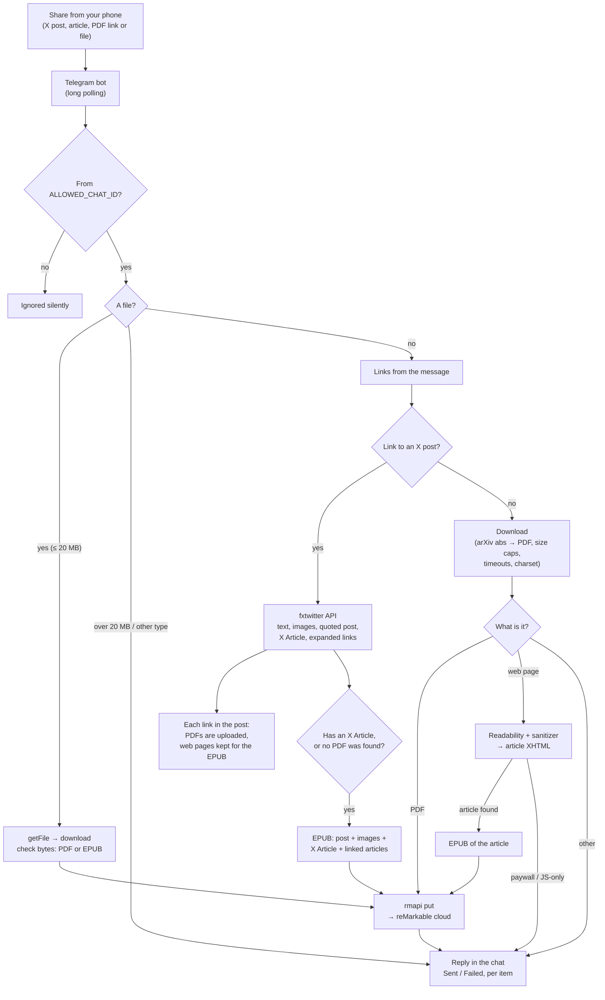
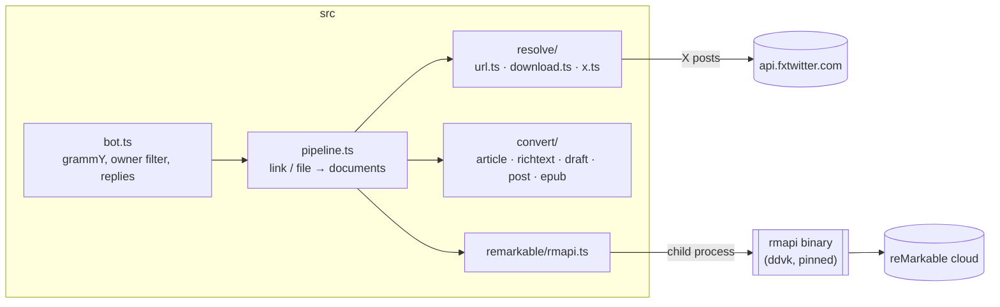

# Architecture

How a shared message becomes a document on the reMarkable, for contributors and the curious.
For what each external API actually returns, see [research.md](research.md).

## Detailed flow

## Code layout

Entry points: `index.ts` (the bot), `cli.ts` (`pnpm send`), `preview.ts` (`pnpm preview`), `check.ts`
(`pnpm check`).

## Decisions

- **Telegram as the trigger, long polling.** The share sheet gives a free "send to…" on every phone; polling needs
  no public URL or inbound port, so the bot runs anywhere a process can stay alive.
- **X posts through [fxtwitter](https://github.com/FxEmbed/FxEmbed)** (free, no account), behind an `XResolver`
  interface so it can be swapped for the official X API if it ever breaks. X Articles arrive as Draft.js content and
  are rendered to XHTML with their images.
- **EPUB for posts and articles** because it reflows on e-ink; PDFs are uploaded untouched. The EPUB writer is
  hand-rolled on [fflate](https://github.com/101arrowz/fflate) (EPUB 3 + an NCX for older readers); generated books
  pass [EPUBCheck](https://github.com/w3c/epubcheck) with no errors or warnings.
- **Web pages** are parsed with [Readability](https://github.com/mozilla/readability) in jsdom with scripts and
  subresources disabled, then rebuilt from an allowlist of tags and attributes into strict XHTML: links and lazy
  images are made absolute, Next.js image proxies are unwrapped to the original file, and scripts, iframes, forms
  and event handlers never reach the EPUB. Pages with too little text (paywalls, JS-only apps) fail clearly.
- **Uploads through [rmapi](https://github.com/ddvk/rmapi)** (the maintained `ddvk` fork), pinned to a
  checksum-verified release and run with `-ni` so it fails instead of hanging when it isn't paired. There is no
  official reMarkable API; rmapi is reverse-engineered and can break, so upload errors are always reported in the
  chat. Same-name documents get a date suffix rather than `--force` (which would wipe annotations).
- **rmapi config on hosts:** it stores a long-lived device token and derives a fresh user token on each run, so a
  read-only secret is copied to a private temp file (`RMAPI_CONFIG_B64` or a mounted file both work).
- **No build step.** Node 24 runs the TypeScript directly (type stripping); `erasableSyntaxOnly` in `tsconfig`
  keeps the code compatible.
- **Supply chain.** pnpm refuses package versions younger than 14 days, Dependabot waits out the same cooldown and
  never proposes majors, GitHub Actions are pinned to commit SHAs, and the Docker base image is pinned by digest.
